# ESP32 Tuya & eWeLink Panel

A 5" ESP32-S3 touch panel for the wall that controls **Tuya / Smart Life** and **eWeLink / Sonoff**
devices straight from their clouds. You don't need Home Assistant, a hub or any other server.

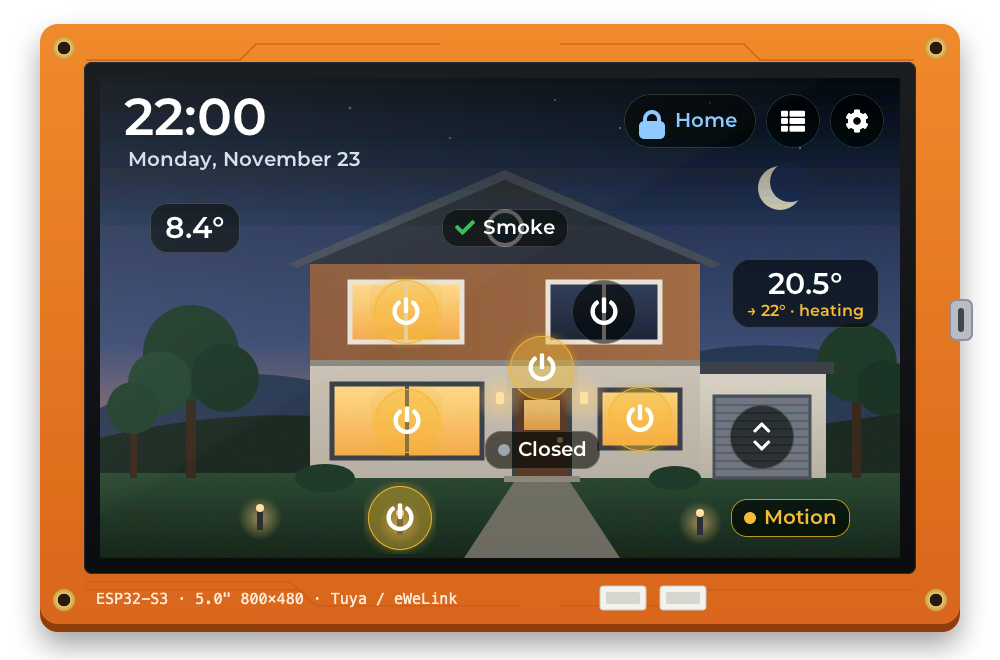

The home screen is a photo of your house. Lights, blinds, thermostats, temperatures and sensors
sit on the photo where they really are, and you tap a window to switch that light on. Everything
else is set up from your phone: scan a QR code on the panel and a small web app opens.

> The user interface is available in **English** (the default) and **Serbian (Latin script)**. Switch it
> on the panel under **Settings → Web** or in the phone web app's **Accounts** tab (see
> [Language](#language)). This documentation quotes the English on-screen labels.

---

## Features

- **Both clouds at once**. The panel finds every supported device in your Tuya (Smart Life) account
  and your eWeLink account by itself.
- **Photo home screen**:
  - Up to 6 pages (for example front, back and living room), each with its own photo, swiped
    left and right.
  - Devices are placed by drag & drop from the phone.
  - A light can be a round button or an *invisible* touch area over the lamp in the photo, which
    glows when the light is on.
- **Device list** with tiles grouped as Alarm, Scenes, Temperature, Lights, Switches, Sockets, Blinds,
  Climate, Security and Other. It also has a **Lights off** button.
- **Device types**:
  - switches and lights (multi-channel included)
  - blinds/covers with position
  - thermostats and radiator valves
  - temperature sensors
  - door/window and motion/presence sensors
  - smoke detectors
  - Tuya alarm hubs (arm away/home, disarm with a PIN, exit-delay countdown)
- **Smoke alarm takeover**: the screen wakes up and shows a full-screen red warning until you
  acknowledge it.
- **Scenes**: one button sets many devices, e.g. "Leaving" turns off the lights, closes the blinds
  and arms the alarm.
- **Phone web app** (QR code + PIN): layout editor, photo upload and cropping, scenes, enabling or
  disabling devices, screen timeouts, cloud accounts and Wi-Fi.
- **English or Serbian**: the panel and the web app share one interface language, switchable on the
  panel or from the phone.
- **Saves API calls**: the panel refreshes every 10 s while someone uses it and every 5 min while
  idle, so it fits within free cloud plans.
- **Stable display**: LVGL 9 in DIRECT mode with two PSRAM framebuffers and a bounce buffer. The
  panel was tuned so the picture doesn't flicker or tear while Wi-Fi and flash are busy.

## Screenshots

### Panel (800 × 480)

| | |
|---|---|
| 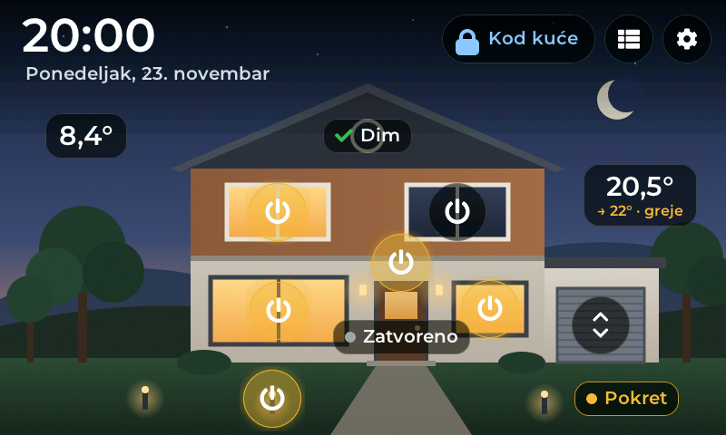<br>Home screen: devices placed on the house photo | 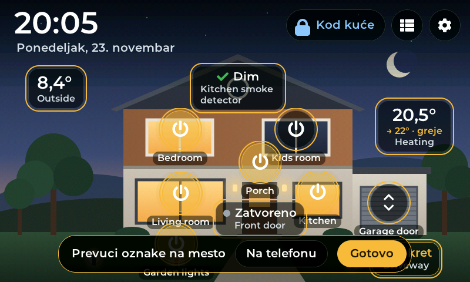<br>Layout edit mode (long press on the photo) |
| 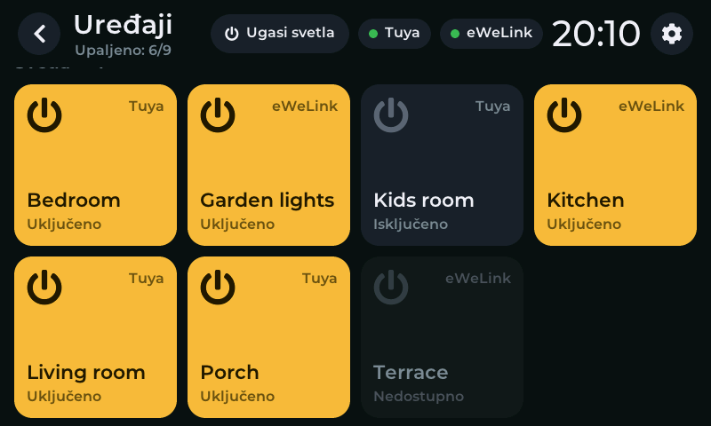<br>Device list grouped by type | 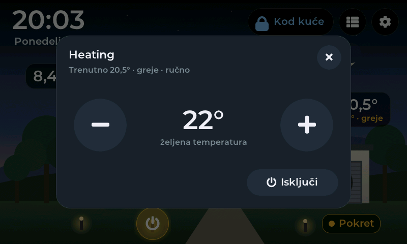<br>Thermostat pop-up |
| 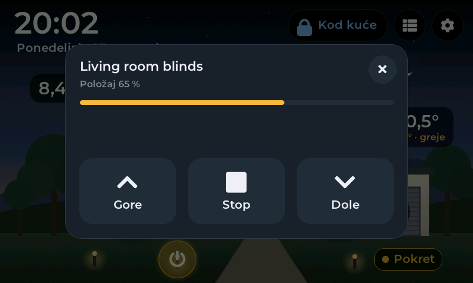<br>Blind / cover pop-up | 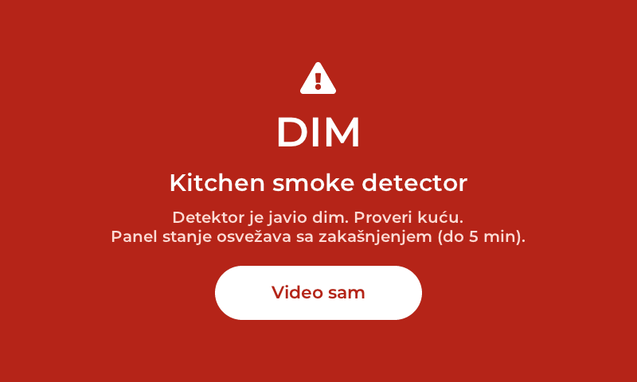<br>Smoke alarm warning |
| 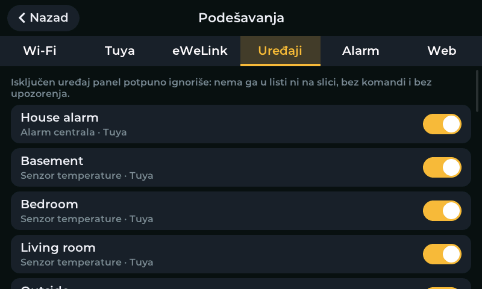<br>**Settings → Devices**: enable or disable devices | 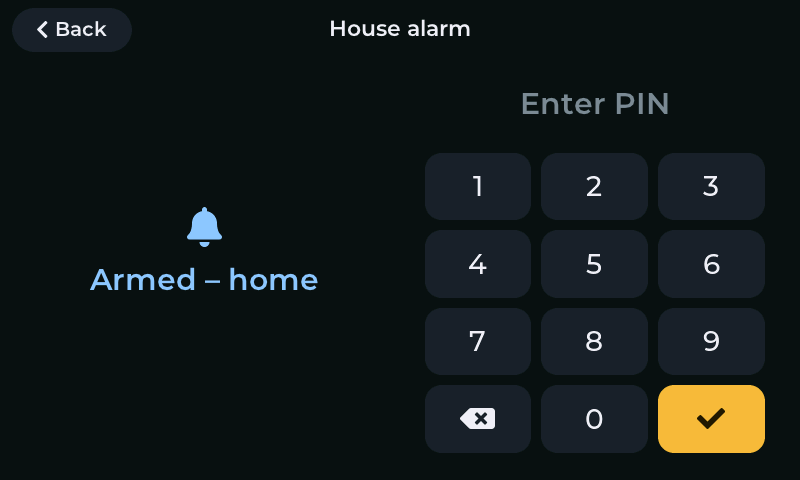<br>Alarm hub screen with the PIN keypad |

### Phone web app

| Layout | Scenes | Devices | Accounts |
|---|---|---|---|
| 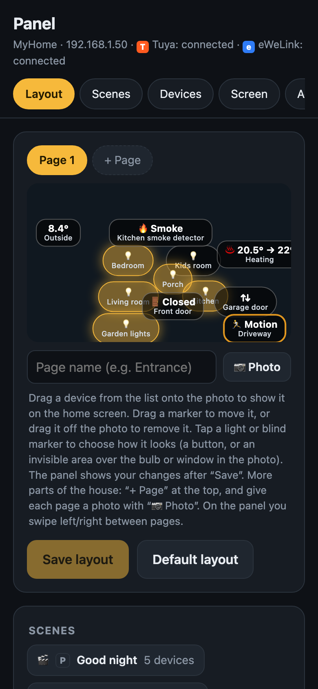 | 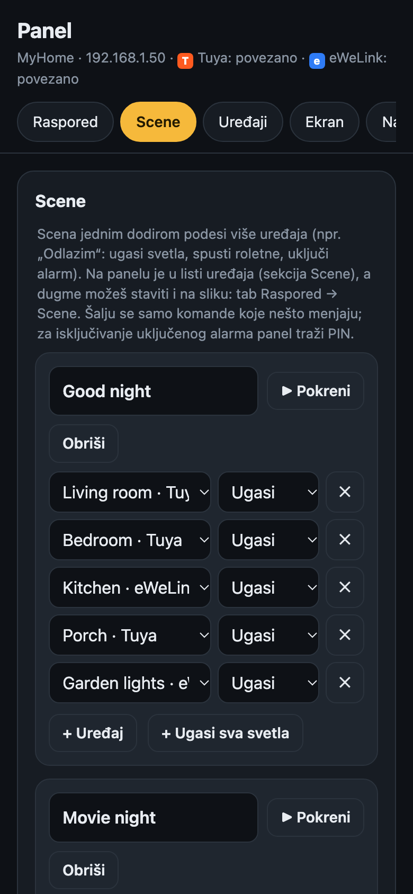 | 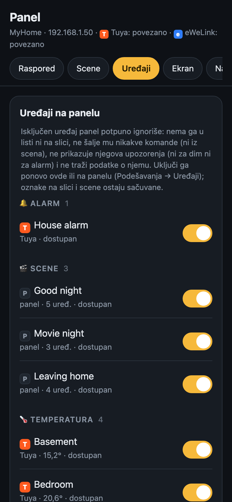 | 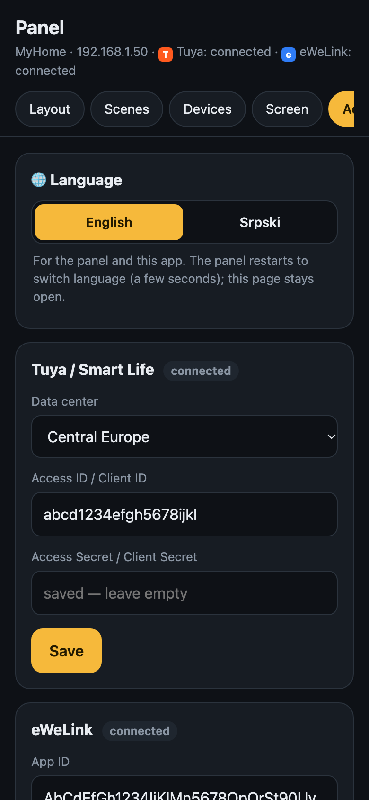 |

*All screenshots show demo data (console command `show`) on the built-in drawn house, not a real home.*

---

## Hardware

| | |
|---|---|
| Board | **Sunton ESP32-8048S050** (sold as Guition **JC8048W550**), 5" 800×480 IPS, capacitive touch |
| MCU | ESP32-S3 (ESP32-S3R8): 16 MB QIO flash, 8 MB octal PSRAM |
| Display | ST7262, 16-bit parallel RGB565 |
| Touch | GT911 over I²C (SDA 19, SCL 20, RST 38) |
| Backlight | GPIO 2 (PWM) |
| USB | CH340 USB-serial (flashing and the debug console) |

All pins and display timings are in [include/config.h](include/config.h). No wiring is needed: the board
only needs a 5 V USB supply.

> Other ESP32-S3 800×480 RGB boards may work if you adapt the pins and timings in `config.h`.
> Only the board above has been tested.

---

## Quick start

You need [PlatformIO](https://platformio.org/) (the VS Code extension or the CLI).

```bash
git clone https://github.com/NikolaMl/esp32-tuya-ewelink-panel.git
cd esp32-tuya-ewelink-panel
pio run -t upload        # build and flash (USB port is auto-detected)
pio device monitor       # serial log, 115200 baud
```

1. **Wi-Fi**: on the panel tap the gear icon, then **Wi-Fi → Scan**. Pick your network, enter the
   password, then tap **Save and connect**. The ESP32 only supports **2.4 GHz** Wi-Fi.
2. **Tuya / Smart Life**: create a free cloud project on [iot.tuya.com](https://iot.tuya.com) and link your
   Smart Life app account to it. Then enter the **Access ID** and **Access Secret** on the panel or in
   the web app. See [docs/SETUP.md](docs/SETUP.md#tuya--smart-life).
3. **eWeLink / Sonoff** (optional): register as a personal developer on
   [dev.ewelink.cc](https://dev.ewelink.cc) and create an app. Enter its **App ID** and **App Secret**,
   then tap **Link account** and sign in. See
   [docs/SETUP.md](docs/SETUP.md#ewelink--sonoff).
4. **Phone web app**: open **Settings → Web** on the panel and scan the QR code with a phone on the
   same Wi-Fi. Drag your devices onto the house photo, upload your own photo and create scenes.

Optionally, you can bake initial Wi-Fi and cloud keys into the firmware: copy
`include/secrets.example.h` to `include/secrets.h` and fill it in. `secrets.h` is git-ignored, and
values saved on the panel always take precedence.

The full step-by-step guide is in **[docs/SETUP.md](docs/SETUP.md)**.

---

## Using the panel

### Home screen

| Element / action | What it does |
|---|---|
| Clock and date (top left) | Local time from NTP. The time zone is `TIMEZONE` in `config.h` (default: Central European Time). |
| Wi-Fi icon (top right) | Red when Wi-Fi is not connected. |
| Padlock (top right) | Alarm state: open = disarmed, closed = armed. Tap it to open the alarm screen. |
| List button | Opens the **device list**. |
| Gear | Opens **Settings**. |
| Light button on the photo | Tap toggles the light. It turns yellow when the light is on. |
| *Invisible* light area | A faint circle over the lamp in the photo; it glows when the light is on. |
| Blind on the photo | Tap opens **Up / Stop / Down** with the position, if the module reports one. |
| Thermostat on the photo | Shows the current temperature and the target. Tap opens the thermostat pop-up. |
| Temperature on the photo | Display only. |
| Door / motion / smoke on the photo | Shows the state, e.g. *Open*, *Motion*, *SMOKE!*. |
| Scene button **▶ Name** | Runs the scene. |
| Swipe left / right | Moves to the next or previous page. Dots at the bottom show the current page. |
| Long press on the photo (~1 s) | **Edit mode**: drag the markers, then **Done**. **On phone** opens the QR code for the web app. |

When the screen turns off, the panel always goes back to the first page.

### Device list

- Tiles are grouped by type. Tap a switch or light tile to toggle it; the tile is yellow when on.
- **Lights off** turns off every light and wall switch that is on. It leaves sockets, pumps and
  other devices alone.
- Blind tiles have **▲ ■ ▼** buttons. Tapping the tile opens the pop-up with the position.
- Thermostat tiles show *current → target* and "heating". Tapping one opens the pop-up.
- The **Tuya** and **eWeLink** dots in the header show the connection: green = connected,
  yellow = connecting, red = error. Tap a dot to see the message.
- The list returns to the home screen by itself after 1 minute without touch.

### Pop-ups

- **Thermostat**:
  - **−** and **+** change the target right away on screen. The command is sent 1.2 s after your
    last tap, so five taps send one command.
  - **Turn on / Turn off** appears only if the device has a power switch.
  - The pop-up closes after 30 s without touch.
- **Blind**: **Up / Stop / Down** plus the position. It also closes after 30 s without touch.

### Alarm (Tuya alarm hub)

- **Arming** (away or home) needs no PIN. The panel starts the exit-delay countdown at once.
- **Disarming** needs the PIN you set on the panel under **Settings → Alarm** (4–8 digits).
  - After 5 wrong attempts the keypad locks for 30 s. Each further wrong attempt doubles the lock,
    up to 16 min.
  - The PIN is stored only as a salted SHA-256 hash.
- When the hub reports an **alarm**, the screen wakes up and shows the alarm screen with the zone name.
- Once an alarm PIN is set, it also protects **Settings**.

### Smoke detectors

When a smoke detector reports smoke, the screen wakes up and shows a full-screen red warning.
It stays until you tap **Got it**; a new alarm opens it again. The screen does
not turn off while the warning is unacknowledged.

> The panel sees cloud state only when it refreshes (every 10 s while in use, up to 5 min while
> idle). The fast alert comes from the detector itself and the Smart Life app. Treat the panel as an
> extra display, not as a life-safety device.

### Scenes

A scene is one button that sets several devices. Scenes are created in the web app (**Scenes** tab)
and run from the panel: from the **Scenes** section of the list, or from a **▶** button on the photo.

- Only commands that change something are sent.
- If the scene disarms an armed alarm, the panel asks for the PIN first.
- A message at the bottom says how many commands were sent.

Limits: 16 scenes with up to 32 actions each.

| Device | Possible actions |
|---|---|
| Switch / light | on, off |
| Blind | open, close, stop |
| Alarm hub | arm away, arm home, disarm (PIN on the panel) |
| Thermostat | off, on, on at X° |

### Screen timeouts

The screen dims after 15 s and turns off after 20 s. You can change both in the web app
(**Screen** tab; 0 = never off). While **Settings** is open, the screen stays on for about
2 minutes, so you have time to type keys or scan a QR code.

- The first touch only wakes the screen; it never presses a button.
- During an alarm, the exit delay or a smoke warning, the screen stays on.

### Language

The panel and the phone web app share one interface language: **English** (the default on a fresh
panel) or **Serbian** (Latin script). You can switch it in two places:

- **On the panel**: **Settings → Web**, row **Jezik / Language**, buttons **English** and **Srpski**.
- **In the web app**: **Accounts** tab, first card **Language** (**English** / **Srpski**).

The panel saves the choice and restarts within a few seconds to apply it. The web app switches at once
and stays logged in, because the web PIN is kept across this restart.

---

## Phone web app

Open **Settings → Web** on the panel (or long press the photo, then **On phone**) and scan the
QR code with a phone on the **same Wi-Fi**. The QR code already contains the PIN.

| Tab | What you set there |
|---|---|
| **Layout** | Home screen pages and what is on them. See below. |
| **Scenes** | Create, rename and delete scenes, pick a state for each device, and run a scene (**▶ Run**) to test it. Scenes are stored on the panel in `/scenes.json`. |
| **Devices** | All devices by group, each with an on/off toggle and a source icon (see below). |
| **Screen** | Seconds until the screen dims or turns off. |
| **Accounts** | Interface language (see [Language](#language)); Tuya data center, Access ID/Secret; eWeLink App ID/Secret and **Link account**; Wi-Fi. |

**Layout** in detail:

- Page tabs across the top; **+ Page** adds a page.
- Per page:
  - a name;
  - **📷 Photo** to pick a photo, then crop it with your finger or sliders while you see the
    markers on it, then send it to the panel;
  - **Restore built-in** to go back to the built-in photo (on the other pages this button is
    **Remove photo**);
  - **Delete page** to delete the page.
- Drag devices from the list onto the photo to place them, and drag a marker off the photo to
  remove it.
- Tapping a light or blind marker picks its style: **● Button** or **◌ Invisible** (invisible
  area). The same switch can be placed several times, e.g. once on every lamp.
- **Save layout** saves the layout, and the panel updates at once.

**Source icons** in **Devices**: orange **T** = Tuya, blue **e** = eWeLink, grey
**P** = a scene made on the panel. The same icons appear in the Layout palette. In the scene editor,
device names end with "· Tuya" or "· eWeLink".

**Disabling a device** (toggle in **Devices**, or **Settings → Devices** on the panel) means the
panel **ignores it completely**:

- it disappears from the list and the photo;
- the panel never sends it a command, not even from scenes;
- its warnings (smoke, alarm) are ignored;
- no extra cloud queries (specifications, logs) are made for it.

Tuya still includes the device in the account's device list; the panel just skips it. Its markers and
scene actions stay saved and work again as soon as you re-enable it.

---

## Supported devices

| Kind | Tuya | eWeLink |
|---|---|---|
| Lights, wall switches, relays, sockets (1–4+ channels) | ✔ (DP `switch`, `switch_N`, `switch_led`, `switch_led_N`) | ✔ (`switch` / `switches[]`) |
| Blinds / curtains | ✔ (`cl`, `clkg`, or any device with DP `control` = open/stop/close) | – |
| Thermostats, radiator valves, heaters/ACs with `temp_set` | ✔ (`wk`, `wkf`, …) | – |
| Temperature sensors | ✔ (`va_temperature`, `temp_current`, …) | – |
| Door / window sensors | ✔ (`doorcontact_state`) | – |
| Motion / presence sensors | ✔ (`pir`, `presence_state`) | – |
| Smoke detectors | ✔ (`ywbj`) | – |
| Alarm hub | ✔ (`mal`) | – |

Full details (categories, DP codes, eWeLink UIIDs, grouping, adding new types):
**[docs/DEVICES.md](docs/DEVICES.md)**.

On eWeLink, only devices returned by the eWeLink cloud API (Sonoff/CoolKit devices) appear.
Third-party devices added to the eWeLink app do not.

---

## Cloud API limits and refresh rate

| | |
|---|---|
| Refresh while in use | every **10 s** (for 90 s after the last touch) |
| Refresh while idle | every **5 min**; touching the panel refreshes at once |
| After a command | the tile changes at once, and the real state is checked ~4 s later |
| Tuya | The free **Trial** IoT Core plan lasts a few months and has a monthly call quota. When it expires the panel shows an error; extend it on iot.tuya.com (**Cloud → Cloud Services → IoT Core → Extend Trial Period**), usually approved within hours. |
| eWeLink | The free personal developer app is limited to **50,000 API calls per month** and is valid for **one year**. |

The refresh intervals are in [include/config.h](include/config.h) (`POLL_ACTIVE_MS`, `POLL_IDLE_MS`,
`ACTIVE_WINDOW_MS`).

---

## Security notes

- **Web PIN**:
  - The web app is plain **HTTP on your LAN**. Every request needs a random 6-digit PIN that is
    generated again at **every boot** (only the panel's own restart after a language change keeps
    it). It is shown on the panel (**Settings → Web**) and built into the QR code.
  - After 10 *different* wrong PINs, web access locks for 60 s (HTTP 429). A tab left open from before
    a reboot keeps repeating the same stale PIN; that is not counted as guessing, and the page simply
    asks for the new PIN.
  - Don't expose the panel to the internet.
- **Secrets**:
  - Cloud secrets are stored in the panel's NVS and **never sent back** by the web API; it only
    reports whether a secret is saved.
  - `include/secrets.h` is git-ignored.
- **Alarm**:
  - The alarm PIN is stored as a salted SHA-256 hash and can only be changed on the panel itself.
  - Sensitive alarm hub data points (keypad password, phone numbers, admin data) are never read,
    logged or displayed.
- **Cloud and OAuth**:
  - TLS certificates of the cloud APIs are verified with the ESP-IDF root CA bundle.
  - The eWeLink sign-in link is protected by a one-time `state` value that is valid for 10 min.

---

## Troubleshooting

| Symptom | What to check |
|---|---|
| `Tuya 1004` | Wrong Access Secret. |
| `Tuya 1106` | Your Smart Life account is not linked to the cloud project (Devices → Link App Account). |
| `Tuya 28841002` | The Tuya trial expired. Extend it on iot.tuya.com. |
| `Tuya 28841101` / `28841105` | IoT Core service is not added, or the project's data center doesn't match your app account's region. |
| eWeLink "account not linked" | Sign-in never reached the panel. The phone must be on the **same Wi-Fi** (not mobile data), and the Redirect URL on dev.ewelink.cc must be exactly `http://<panel-ip>/ewelink/callback`. |
| eWeLink "login expired" | The refresh token expired (panel off for more than 60 days). Tap **Link account** again. |
| eWeLink "monthly API call limit reached" | The 50,000 calls/month quota is used up. |
| A device is missing | Check the serial log for `[tuya] nije podrzan: <name> (kategorija X) DP: …`: that category isn't supported yet (see [docs/DEVICES.md](docs/DEVICES.md#adding-support-for-a-new-device)). Also check that it isn't disabled under **Devices**. |
| Web app: "Wrong PIN" | The panel rebooted and the PIN changed. Scan the QR code again. |
| Picture flickers / dashes | See [docs/DEVELOPMENT.md](docs/DEVELOPMENT.md#display-pipeline-and-flicker); the `rf` console command logs every redraw. |
| Panel crashed or rebooted | The boot log prints the reset reason and, after a crash, a coredump summary (see DEVELOPMENT.md). |

---

## Project structure

```
include/          config.h (pins, timings, categories), lv_conf.h, secrets.example.h
                  (optional, git-ignored: secrets.h, home_positions.h)
src/main.cpp      setup / loop, screen power management, boot diagnostics
src/board/        RGB display driver + LVGL glue, GT911 touch
src/model/        DeviceStore (shared state), settings (NVS), scenes, device models
src/net/          cloud task, Tuya and eWeLink clients, HTTPS session, web portal + embedded web app
src/ui/           home screen, device list, pop-ups, alarm screen, smoke alert, settings, theme, fonts
src/debug/        serial debug console (screenshots, demo data, test commands)
tools/            screenshot.py, serial_log.py, make_background.py, bin2c.py
assets/           built-in home screen image (drawn house: demo-house.svg -> .png -> background.rgb565), Montserrat font (OFL)
docs/             setup, devices and development guides; screenshots in docs/images/
partitions.csv    5 MB app + ~10.9 MB LittleFS for photos and scenes + coredump
```

Architecture, display notes, debug console and tools: **[docs/DEVELOPMENT.md](docs/DEVELOPMENT.md)**.

---

## License

[MIT](LICENSE).

Third-party components:

- [LVGL](https://lvgl.io) 9.2.2 (MIT)
- [ArduinoJson](https://arduinojson.org) 7.2.1 (MIT)
- Arduino-ESP32 / ESP-IDF via [pioarduino](https://github.com/pioarduino/platform-espressif32)
  (Apache 2.0 / LGPL)
- [Montserrat](https://github.com/JulietaUla/Montserrat) SemiBold font (SIL Open Font License 1.1, see
  [assets/fonts/OFL.txt](assets/fonts/OFL.txt))

This project is not affiliated with Tuya, Smart Life, eWeLink, CoolKit, Sonoff or Sunton. All trademarks
belong to their owners.
